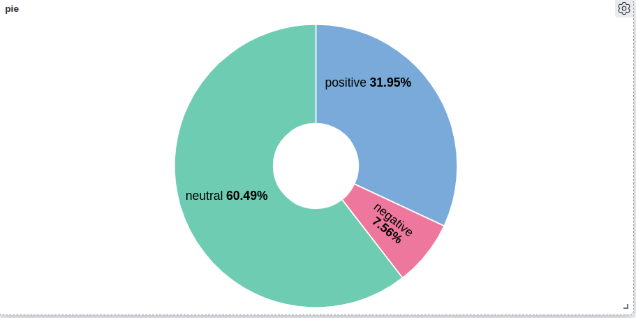
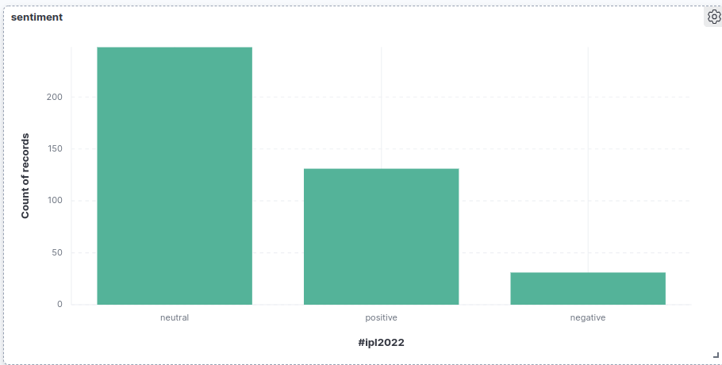

# Streaming with Real-time Tweets

Real-time sentiment analysis pipeline for live tweets: **Twitter/X API → Kafka → Spark Structured Streaming → Elasticsearch → Kibana**.

The demo tracks the `#ipl2022` hashtag, classifies every tweet as **positive / neutral / negative** as it arrives, and visualizes the sentiment distribution live in Kibana.

    

---

## Architecture

```
┌──────────────┐   tweets    ┌─────────────┐  topic: tweets  ┌──────────────────────────┐  index: new_tweets  ┌───────────────┐   ┌─────────┐
│ Twitter / X  │ ──────────▶ │ scrapper.py │ ──────────────▶ │ sentimental.py           │ ──────────────────▶ │ Elasticsearch │ ─▶│ Kibana  │
│ Filtered     │  (tweepy    │ Kafka       │                 │ Spark Structured         │  (es-hadoop sink)   │               │   │ charts  │
│ Stream API   │  Streaming  │ producer    │                 │ Streaming + TextBlob UDF │                     └───────────────┘   └─────────┘
└──────────────┘  Client)    └─────────────┘                 └──────────────────────────┘
                                                    └──────▶ clustering.py (Spark MLlib K-Means, micro-batches every 30s → plots/)
```

| Component | File | What it does |
|---|---|---|
| **Ingestion** | `scrapper.py` | Subclasses tweepy's `StreamingClient`, registers a hashtag rule (`#ipl2022`), extracts each tweet's text, and publishes it to the Kafka topic `tweets`. |
| **Sentiment (streaming)** | `sentimental.py` | Spark Structured Streaming job that reads the Kafka topic, scores each tweet with a TextBlob polarity UDF (`< 0` negative, `= 0` neutral, `> 0` positive), and streams the results into the Elasticsearch index `new_tweets`. |
| **Clustering (experimental)** | `clustering.py` | Every 30 seconds, reads the topic in batch mode, runs Spark MLlib **K-Means (k=3)** on the tweets, and saves a scatter plot of the clusters to `plots/<run>.png`. |
| **Configuration** | `config.py` | Kafka and Elasticsearch endpoints plus the API token, all read from environment variables. |

---

## Results

Sentiment for `#ipl2022` tweets, shown live in Kibana:

| Sentiment distribution | Tweet counts by sentiment |
|---|---|
|  |  |

In this sample, roughly **60% neutral, 32% positive and 8% negative**. `kibana_plots/initial.png` shows the dashboard early in the stream, before many tweets had arrived.

---

## Getting started

### Prerequisites

- Python 3.7 (PySpark 2.4.x does not support newer Python versions)
- Java 8
- Apache Kafka (with ZooKeeper)
- Elasticsearch and Kibana
- A Twitter/X API v2 **bearer token** with filtered-stream access

### 1. Install dependencies

```bash
pip install -r requirements.txt
python -m textblob.download_corpora
```

### 2. Configure secrets

Credentials are **never committed**. Copy the template and add your token:

```bash
cp .env.example .env          # .env is git-ignored
export $(grep -v '^#' .env | xargs)
```

| Variable | Default | Purpose |
|---|---|---|
| `TWITTER_BEARER_TOKEN` | *required* | Twitter/X API v2 bearer token |
| `KAFKA_URL` | `localhost:9092` | Kafka bootstrap server |
| `KAFKA_TOPIC` | `tweets` | Topic for raw tweets |
| `ES_HOST` / `ES_PORT` | `localhost` / `9200` | Elasticsearch node |

### 3. Start Kafka and create the topic

```bash
bin/zookeeper-server-start.sh config/zookeeper.properties
bin/kafka-server-start.sh config/server.properties
bin/kafka-topics.sh --create --topic tweets --bootstrap-server localhost:9092
```

### 4. Start Elasticsearch and Kibana

Start both services with their default settings (Elasticsearch on `localhost:9200`, Kibana on `localhost:5601`).

### 5. Run the pipeline

```bash
# Terminal 1 — stream tweets into Kafka
python scrapper.py

# Terminal 2 — sentiment analysis into Elasticsearch
python sentimental.py

# (optional) Terminal 3 — periodic K-Means clustering plots
python clustering.py
```

The Spark jobs pull the Kafka and Elasticsearch connectors automatically through `spark.jars.packages`.

### 6. Visualize

In Kibana, create a data view for the `new_tweets` index and build charts on the `polarity` field (for example a pie chart and a bar chart of record counts).

To track a different topic, change the `hastag` value in `scrapper.py`.

---

## Tech stack

**Python** · **tweepy** · **Apache Kafka** (`kafka-python`) · **Apache Spark 2.4** (Structured Streaming, MLlib) · **TextBlob** · **Elasticsearch** (es-hadoop connector) · **Kibana**
